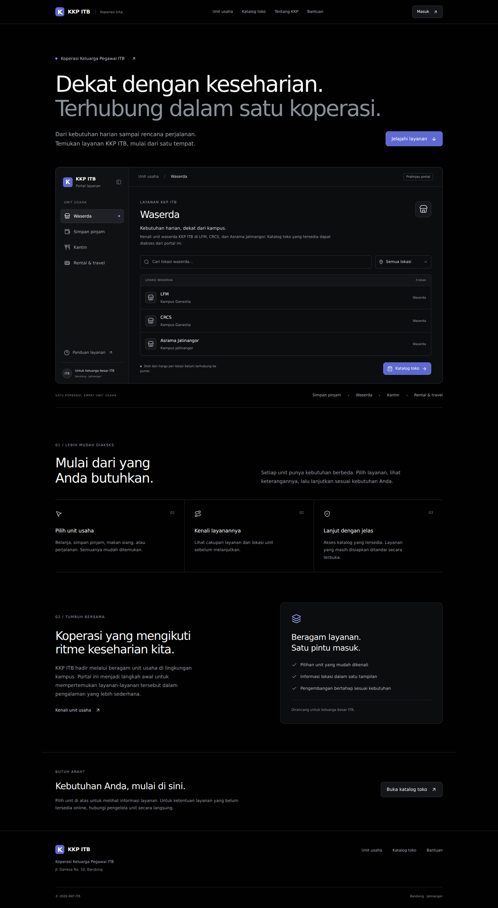
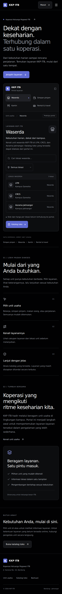

# KKP ITB portal redesign

The merchandise-only home page is now an Indonesian KKP ITB service portal. The supplied Linear reference informs the near-black canvas, restrained lavender accent, hairline dividers, and dense interactive service panel. Shared navigation, footer, identity, metadata, and the catalog follow the same direction.

## Included

- Four service views: waserda, simpan pinjam, kantin, rental & travel.
- Waserda location selector for LFM, CRCS, and Asrama Jatinangor; contextual search and empty results.
- Catalog search using the existing repository, with visibly labelled demo fallback and empty states.
- Responsive mobile navigation; accessible control labels, focus rings, and browser zoom.
- Existing account, cart, admin, and product-detail routes remain connected. Their transactional UI and backend are not redesigned here.

This is a portal design and discovery layer. It does not integrate SAKTI, location-level stock, savings/loans, menus, or travel reservations. The UI explicitly identifies unavailable online capabilities. The catalog retains the existing product data; it is not represented as actual waserda inventory.

## Validation

- `node node_modules/typescript/bin/tsc --noEmit`: passed separately because the repository's Next configuration skips build-time type checking.
- `next build`: passed. Existing database-backed routes report missing `DATABASE_URL` in the local environment; real transactions were not tested.
- Playwright against the production build: four service selections, location filtering, search empty/reset states, mobile menu open/close, catalog search submission and empty state passed; no page errors.
- No horizontal overflow at 320, 390, or 768 pixels. Desktop (1440 pixels) and mobile (390 pixels) screenshots visually reviewed.

## Screenshots

